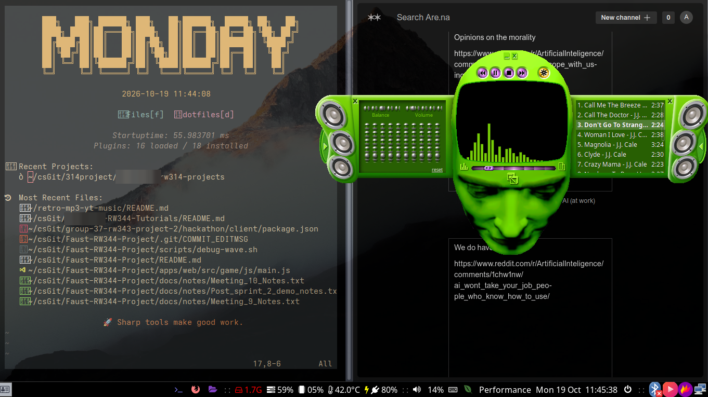
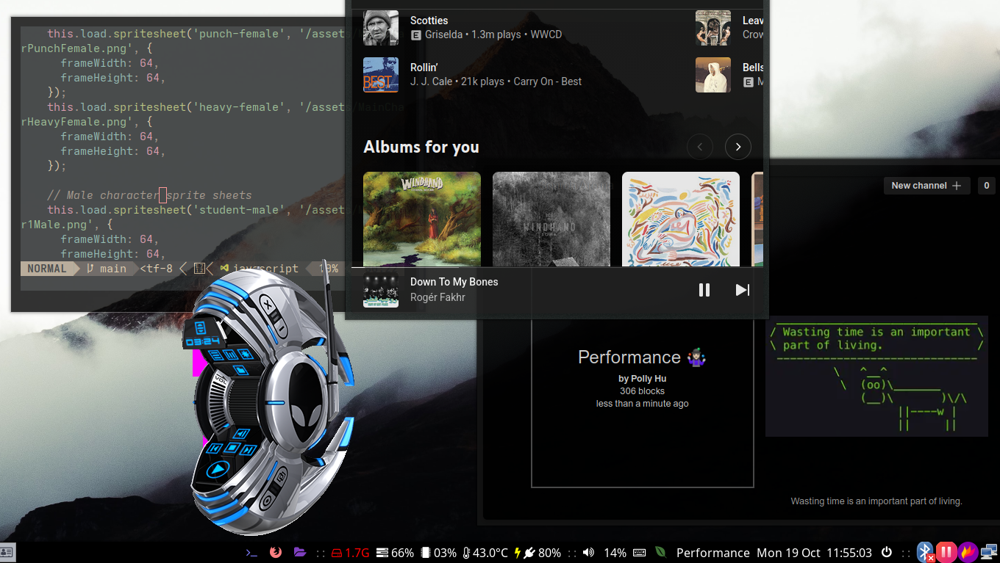

# Y2K-MP3-Streamer
Y2K themed front-end for YouTube Music (Linux, Windows) and Spotify (Linux, Windows)



*The skin shown is not mine. It was designed by Microsoft for Windows Media Player; this image is only here to show what the app looks like with a skin loaded. The skins are not included in this repo (see below).*



*Also not mine: the Alienware Invader skin, made by The Skins Factory (the Alienware name and logo belong to their owner). Shown only to illustrate the app.*

Has swappable retro skins and real audio visualizer.
Controls playback (MPRIS on Linux, Pear's local API on Windows; Spotify over MPRIS on Linux and the Windows media session on Windows) and renders in custom retro skins with
audio-driven visualisers (cava on Linux, WASAPI loopback on Windows).

Inspired by something I saw on IG: https://www.instagram.com/p/Delqq-ngEdE/

Pulling skins from old Windows Media Player skins: https://archive.org/details/windowsmediaplayerskinscollection

Another winamp skins site for you guys to choose from: https://skins.webamp.org/

If you find a skin you like, make an issue for me to add it

## How it works

```
YouTube Music desktop app  --MPRIS (Linux) / local HTTP API (Windows)-->  Tauri backend (Rust)  --events-->  skin renderer (TS)
  (login, streaming, ads)                       cava / WASAPI loopback for the visualizer                    .wmz/.wms + JScript shim
```

- **Playback engine:** th-ch's YouTube Music desktop app (now called [Pear Desktop](https://github.com/pear-devs/pear-desktop)) runs in the background. This app never talks to YouTube.
- **Control:** play/pause/stop/next/previous, seek, volume, shuffle/repeat and track metadata over MPRIS on Linux, or through Pear's local API server on Windows (`RETRO_PLAYER_BACKEND=api` forces the API backend anywhere, `mpris` forces MPRIS).
- **Stop quits everything:** the stop button (home player or any skin) also closes the skin window and the app, and quits Pear (or Spotify) if this app started it. A player this app didn't start, such as a browser tab, is only stopped, never closed.
- **Skins:** real Windows Media Player `.wmz` skins are unzipped, their `.wms` layout is parsed and rendered, and the skin's own JScript runs against a `player.*` shim that maps onto MPRIS. Winamp classic `.wsz` skins are drawn from their sprite sheets (see [Winamp skins](#winamp-classic-skins-wsz)).
- **Visualizer:** on Linux [cava](https://github.com/karlstav/cava) reads PipeWire; on Windows the app captures the default output device (WASAPI loopback) and runs an FFT. Either way bar data streams to the skin's effects area.

## Install (Arch / EndeavourOS)

1. System packages:
   ```sh
   sudo pacman -S --needed base-devel webkit2gtk-4.1 gtk3 librsvg rust nodejs npm cava
   yay -S pear-desktop-bin         # the playback engine, formerly youtube-music-bin (AUR)
   ```
   `cava` is optional (no visualizer without it). Other distros: see the [Tauri 2 prerequisites](https://tauri.app/start/prerequisites/#linux).
2. Clone and install JS dependencies:
   ```sh
   git clone https://github.com/Angelo10101/Y2K-MP3-Streamer.git && cd Y2K-MP3-Streamer
   npm install
   ```
3. **Add a skin.** Skins are copyrighted and are *not* in this repo (`skins/` is gitignored). Put `.wmz` (Windows Media Player) or `.wsz` (Winamp) files in `skins/`, e.g. `skins/Headspace.wmz`. Old WMP skins are collected at the [Internet Archive](https://archive.org/details/windowsmediaplayerskinscollection), and Winamp skins at the [Winamp Skin Museum](https://skins.webamp.org/).
   - Skins are searched for in `$RETRO_SKINS_DIR`, `./skins`, next to the executable, then `~/.local/share/y2k-mp3-streamer/skins` (the old `~/.local/share/retro-mp3-yt-music/skins` from before the rename still works).
   - To try the app without a real skin: `python3 scripts/make_test_skin.py` generates a small original `skins/TestSkin.wmz`.
4. Nothing else to do for the player: on first launch this app starts Pear itself and, if needed, edits Pear's config (`~/.config/YouTube Music/config.json`, a backup is saved as `config.json.bak-retro-mp3`) to enable the MPRIS and API-server plugins, hide-to-tray on close, and no auto-resume. Log in to your Google account once in Pear's window.
5. Run this app:
   ```sh
   npm run tauri dev        # development
   npm run tauri build      # release binary in src-tauri/target/release
   ```
   If YouTube Music isn't running the app tells you so and keeps retrying.

## Using Spotify instead (Linux, Windows)

> **Status:** written against the MPRIS spec and the Windows media-session API, but not yet run against a real Spotify client. Please report rough edges.

On Linux, Spotify's desktop client (and spotifyd / ncspot) already speak MPRIS, so the same backend drives it. On Windows the app talks to Spotify through the system media session (SMTC), the same thing behind the volume flyout. Set `RETRO_SOURCE=spotify`:

```sh
yay -S spotify                  # or: flatpak install flathub com.spotify.Client
RETRO_SOURCE=spotify npm run tauri dev
```

- On launch the app starts Spotify if it isn't running (`RETRO_SPOTIFY_CMD` overrides the command, e.g. `RETRO_SPOTIFY_CMD="flatpak run com.spotify.Client"`). Log in once in Spotify's window.
- Bus names containing `spotify` are used (this covers the Flatpak and spotifyd). For anything else, e.g. ncspot, set `RETRO_MPRIS_PLAYER=ncspot`.
- **Home** raises Spotify's window (MPRIS `Raise`). The app does not hide Spotify's window when the player opens (closing it could quit Spotify), so both stay visible.
- No config is touched: unlike Pear, Spotify needs no plugins or settings changes.
- Differences from YouTube Music: the playlist drawer shows only the current track (Spotify exposes no queue over MPRIS), and seeking, volume, shuffle and repeat work only as far as your Spotify version implements them over MPRIS. The visualizer (cava) is unchanged since it listens to PipeWire.
- **Windows:** install the Spotify desktop app (installer or Microsoft Store), then in PowerShell `$env:RETRO_SOURCE = "spotify"; npm run tauri dev`. The app starts Spotify from `%APPDATA%\Spotify\Spotify.exe`, or via the `spotify:` link for the Store version (`RETRO_SPOTIFY_CMD` can point at an `.exe`). Windows differences: **volume can't be controlled** (the media session has none; use Spotify or the system volume), the position is advanced locally between Spotify's updates, the album art is read from the session, and **Home** launches Spotify again, which focuses its window. The visualizer captures all system audio, as with Pear.
- To make it permanent put `RETRO_SOURCE=spotify` in your launcher or compositor config, e.g. `exec-once = env RETRO_SOURCE=spotify /path/to/y2k-mp3-streamer` in Hyprland.

## Install (Windows 10/11)

> **Status:** the Windows support is a first attempt. It was written and its logic is unit-tested, but it has not been run on Windows yet. Expect rough edges and please report them.

1. **Prerequisites**
   - [Rust](https://rustup.rs) (the default MSVC toolchain) and the *Desktop development with C++* workload of the [Visual Studio Build Tools](https://visualstudio.microsoft.com/visual-cpp-build-tools/).
   - [Node.js](https://nodejs.org) (LTS).
   - The WebView2 runtime (already on Windows 11 and up-to-date Windows 10; otherwise get the *Evergreen Runtime* from Microsoft).
   - Git.
   - See also the [Tauri 2 Windows prerequisites](https://tauri.app/start/prerequisites/#windows).
2. **Install Pear Desktop** (the playback engine): download the Windows installer from the [releases page](https://github.com/pear-devs/pear-desktop/releases), or try `winget search "YouTube Music"`. This app looks for `%LOCALAPPDATA%\Programs\youtube-music\YouTube Music.exe` (and a few similar places); if yours lives elsewhere, set `RETRO_PEAR_CMD` to the full path of the `.exe`.
3. **Clone and install**
   ```powershell
   git clone https://github.com/Angelo10101/Y2K-MP3-Streamer.git
   cd Y2K-MP3-Streamer
   npm install
   ```
4. **Add skins** to the `skins\` folder in the project (or to `%APPDATA%\y2k-mp3-streamer\skins`; the old `%APPDATA%\retro-mp3-yt-music\skins` still works). They are not in the repo; get `.wmz` files from the [Internet Archive collection](https://archive.org/details/windowsmediaplayerskinscollection) or `.wsz` Winamp skins from the [Skin Museum](https://skins.webamp.org/), or run `python scripts/make_test_skin.py` for a small generated one.
5. **Run it**
   ```powershell
   npm run tauri dev       # development
   npm run tauri build     # installer / exe under src-tauri\target\release
   ```
   On first launch the app starts Pear and, if needed, edits Pear's config at `%APPDATA%\YouTube Music\config.json` (backup: `config.json.bak-retro-mp3`) to enable the local API server, hide-to-tray on close and no auto-resume. Log in to your Google account once in Pear's window. If Pear was already running, close it fully (tray icon > Quit) and start this app again so the config can be applied.

How it differs from Linux:
- **Control** goes through Pear's local API (`127.0.0.1:26538`); there is no MPRIS. Position is reported in whole seconds, so it is smoothed in the UI.
- **Hiding Pear's window:** the app asks Pear's window to close, and Pear hides to the tray; showing it focuses the hidden window (or launches Pear again, which makes Pear show itself).
- **Click-through** on transparent parts of a skin uses a window region (`SetWindowRgn`), and the window is transparent via WebView2.
- **Visualizer** captures whatever your default output device plays, so it reacts to all system audio, not only Pear.
- Set environment variables in PowerShell like this: `$env:RETRO_PEAR_CMD = "C:\path\to\YouTube Music.exe"; npm run tauri dev`.

### How it works day to day
- **Home:** Pear's own YouTube Music window (everything: home, library, playlists, search) plus a small companion panel with the skin chooser, mini controls and an *Open YouTube Music* button.
- **Open the player:** press *Open player* on the companion panel. The player never opens by itself: starting, skipping or auto-advancing songs leaves the home screen as it is.
- **In the player:** the *playlist* drawer shows Pear's real queue (double-click to play a row). The *return to full mode* button (or right-click > Home) hides the player and brings the home screen back. Only one of the two is ever visible.
- Hiding Pear's window works on **X11** and **Windows** (we close it politely and Pear hides to its tray). On Wayland the window can't be hidden, so both stay visible.
- Under i3 add `for_window [class="com.github.th-ch.youtube-music"] floating enable` if you'd rather not have Pear tile.
- Quitting this app leaves Pear (and your music) running.

### Using it
- Drag the skin body to move the window. Buttons, sliders and the visualizer behave as the skin defines.
- **Right-click** the skin for the menu: choose a skin, toggle always-on-top, go Home (YouTube Music), or quit.
- The home panel has the skin chooser (the last choice is remembered). With no skins, it explains where to put them.
- Linux: check that the player is visible to MPRIS: bus names containing `youtube` or `pear` are used (`spotify` with `RETRO_SOURCE=spotify`). If another MPRIS player (e.g. a browser tab) is playing while Pear is idle, the app follows the one that is playing. Set `RETRO_MPRIS_ANY=1` to also fall back to an idle non-Pear player when Pear is absent. Set `RETRO_MPRIS_PLAYER=<substring>` if yours is named differently.

### Hyprland and KDE Plasma (Wayland)

> **Status:** the code paths are the same as on X11 and the window setup is standard GTK, but this has not been run on Hyprland or Plasma yet. Treat the rules below as a starting point.

The app is a frameless, transparent, fixed 900x600 window. On a Wayland compositor you tell it how to treat that window with window rules; the Wayland app id is normally `y2k-mp3-streamer` (check yours with `hyprctl clients`).

**Hyprland** (`hyprland.conf`; Hyprland 0.53+ syntax, older versions use `windowrulev2 = float, class:^(y2k-mp3-streamer)$` and so on):
```ini
windowrule = float on,      match:class ^(y2k-mp3-streamer)$
windowrule = no_shadow on,  match:class ^(y2k-mp3-streamer)$
windowrule = no_blur on,    match:class ^(y2k-mp3-streamer)$
windowrule = no_anim on,    match:class ^(y2k-mp3-streamer)$
windowrule = border_size 0, match:class ^(y2k-mp3-streamer)$
windowrule = pin on,        match:class ^(y2k-mp3-streamer)$   # optional: always on top, on every workspace
```
Without these the window is tiled, and Hyprland draws a border, shadow and blur through the transparent parts. Dragging the skin body moves the window as usual.

**KDE Plasma** (Wayland or X11): transparency works out of the box with KWin's compositor. In *System Settings > Window Management > Window Rules* add a rule matching the window class `y2k-mp3-streamer` and force *No titlebar and frame* (if a frame shows), *Keep above* (the app's "Always on top" menu item can't do this on Wayland) and, if you like, *Skip taskbar*.

**Both:**
- Hiding Pear's window only works on X11 and Windows, so with Pear on Wayland its window and the companion panel both stay visible (Spotify mode never hides its window either).
- If clicks on the transparent parts of the skin don't fall through, or the window doesn't render right, run through XWayland: `GDK_BACKEND=x11 npm run tauri dev`.
- If WebKitGTK shows a blank window on NVIDIA, try `WEBKIT_DISABLE_DMABUF_RENDERER=1`.
- `cava` reads PipeWire, so the visualizer works the same on Wayland. Install `cava` for it.

### Tiling window managers (i3, sway)
The window sets a utility type hint so i3 floats it automatically. If yours still tiles it, add `for_window [class="Y2k-mp3-streamer"] floating enable` to your i3 config. The window has no titlebar; drag the skin body to move it.

### Rendering stalls (window only updates when hovered)
On some Linux setups a WebKitGTK window stops updating until it is focused or hovered, typically after another (tiled) window such as Pear's moves onto the same monitor. This was reproduced with a bare WebKitGTK test window, so it is not specific to this app, and none of the WebKit rendering modes or in-app redraw tricks I tried fixed it. Two things help:
- Make Pear float so it does not re-tile your workspace: `for_window [class="com.github.th-ch.youtube-music"] floating enable` (i3).
- Do not restart picom from a shell (it needs i3's environment): `i3-msg 'exec --no-startup-id picom -b'`.

The app window is a fixed, generous, transparent and click-through size (900x600) and never resizes, because compositors with window animations (picom's `geometry` animation) otherwise animate every resize and can leave stale frames.

### Window transparency
The window is frameless and transparent. You need a compositing manager for the transparent parts to look right: KDE Plasma has one built in; on i3 run e.g. `picom -b`. Without a compositor the transparent areas render black.

Clicks on transparent parts of the skin fall through to the window below (GTK input shape region). Verified on X11 (i3 + picom); on Wayland GTK3 maps it to the surface input region, which should also work but is less tested. If it misbehaves on Wayland, run through XWayland: `GDK_BACKEND=x11 npm run tauri dev`.

## Skin support

Implemented subset of the WMP skin object model:

| Feature | Status |
| --- | --- |
| `view` (size, `backgroundImage`, `clippingColor`/`clippingImage` window shape) | yes |
| `subview` (nesting, visibility, `transparencyColor`, move/alpha animation via `moveTo`/`alphaBlendTo`) | yes |
| `buttonelement` / `button` with hover/down/disabled images | yes |
| WMP's special buttons (`prevelement`, `playelement`, `stopelement`, `nextelement`, `pausebutton`, mute/shuffle/repeat/ff/rw) with built-in actions and automatic enabled state | yes |
| `buttongroup` with `mappingImage` hit-testing | yes |
| `slider` / `customslider` (thumb, foreground/position image, vertical, `borderSize`) | yes |
| `text` (`wmpprop:` bindings, scrolling, fonts, justification) | yes |
| `effects` (bars / scope driven by cava) | yes |
| `playlist` | current track only (see limitations) |
| `wmpprop:` / `wmpenabled:` / `wmpdisabled:` bindings | yes |
| Theme JScript (`scriptFile`, inline `jscript:` handlers) | yes, best effort |
| attribute expressions (`left="jscript:a.left+10;"`), `scriptFile` lists (`res://` DLL entries are replaced by built-in constants), case-insensitive `player.*` names | yes |
| `video`, `vbscript:` | no (placeholders / ignored) |

`player.*` shim: `controls.*`, `currentMedia.*` (`name`, `duration`, `getItemInfo`), `settings.volume/mute/getMode/setMode`, `playState`, `status`, `currentPlaylist` (one item). Player events `onplaystatechange` / `onmediachange` / `onopenstatechange` are dispatched to elements that declare them and to same-named global script functions.

### Winamp classic skins (.wsz)

Winamp 2 skins are a different format from WMP skins: a ZIP of bitmaps (`main.bmp`, `cbuttons.bmp`, `numbers.bmp`, `text.bmp`, ...) with no scripting. This app draws the classic **main window** (the fixed 275x116 layout) from those bitmaps at 2x size, nearest-neighbour scaled, and the **EQ** and **PL** buttons open Winamp's equalizer and playlist windows stacked below it (with all three open the stack is scaled down to fit the window):

| Feature | Status |
| --- | --- |
| Background, title bar, and the skin's own digit and text fonts (`numbers.bmp` / `nums_ex.bmp`, `text.bmp`) | yes |
| Prev / play / pause / stop / next, shuffle and repeat (lit when on), the play-state indicator | yes |
| Elapsed time, and the scrolling song title | yes |
| Volume slider (28-frame background, draggable thumb) and seek bar (drag to seek) | yes |
| Spectrum analyzer in the skin's own colours (`viscolor.txt`, cava on Linux) | yes |
| Window shape from `region.txt` | implemented and unit-tested, but none of the tested skins use one |
| **Eject** button | acts as **Home** (Winamp's eject opens a file dialog, which this app doesn't have) |
| **PL** button: the playlist window (`pledit.bmp` frame, `pledit.txt` colours) | yes: shows Pear's real queue (double-click a row to play it, mouse wheel and scrollbar scroll); with Spotify it lists the current track |
| **EQ** button: the equalizer window (`eqmain.bmp`) | the sliders and ON / AUTO buttons move, but **they have no effect**, since neither MPRIS nor Pear's API has an equalizer |
| Skins missing parts of the playlist or equalizer artwork | drawn with flat widgets in the skin's colours (Winamp would borrow its default skin's sprites, which aren't available here) |
| Balance slider | drawn centred, does nothing |
| Windowshade mode, the playlist's own buttons (+FILE, SEL ALL, ...) and window resizing, the cursors in the archive | no |

Which windows are open is remembered between runs.

Skins in a wrapping folder inside the archive work too (the folder holding `main.bmp` is used).

## Tested skins
All of these load, render like their own preview image, and have a working Home button (checked with real clicks; Winamp skins use the eject button for Home):

| Skin | Notes |
| --- | --- |
| Headspace | full: head shape, controls, visualizer in the screen, EQ and playlist drawers |
| Goo | full |
| Gorillaz | full (its "maximize" button is Home) |
| Israeli (SHAPE) | volume dial is a filmstrip slider; the movie/playlist/EQ panes slide as the skin defines |
| Disney Mix Central | plays its frame-by-frame intro, then the player; digit-strip clock works |
| Back to the Future Trilogy | animated GIF intro, then the dashboard |
| Alienware Invader | WMP 11 skin; always plays its 568-frame shutter intro when opened (at double speed, ~14 s), **double-click the skin to skip it** |
| Tube Frame | full: transport, shuffle/mute, volume and balance drawer, playlist drawer, status line cycling title/album/artist |
| [KTI Kayo Kayo Goo](https://skins.webamp.org/skin/98916ea6e75df8d1df75cb314f4a7781/KTI%20Kayo%20Kayo%20Goo.wsz) (Winamp) | transport, shuffle/repeat, volume, seek, time and title all work; playlist window with the skin's own frame |
| [Mazda RX-7 Blue](https://skins.webamp.org/skin/c2802fb75b68cf4260d2cbd8a06daf91/Mazda_RX-7_Blue.wsz) (Winamp) | same; its volume wedge and seek thumb follow the player, and its equalizer window uses the skin's sprites (no playlist artwork, so a flat playlist frame) |
| [Fallout Pip-Boy 3000 Green v4](https://skins.webamp.org/skin/06312f93d7b9499dc5dd0176133d6d9e/Fallout_Pip-Boy_3000_Green_v4.wsz) (Winamp) | same; the archive wraps its files in a folder |
| [cartmanfart](https://skins.webamp.org/skin/85cbeb54368dd4ba8624507b628c0dec/cartmanfart.wsz) (Winamp) | transport, volume, seek, time and title work; it ships only the main window's art, so its equalizer and playlist windows use the flat fallbacks |
| TestSkin | generated by `scripts/make_test_skin.py` |

Every skin's own "return to full mode" control (`view.returnToMediaCenter()`) is the **Home** button (tooltip "Home (YouTube Music)"). **Esc** goes Home from the player on any skin.

Skins that use several WMP views (EQ, playlist, visualization, video, info windows, e.g. Back to the Future, Disney, Alienware) only show their *main* view; the other views open as separate windows in real WMP and aren't supported here.

## Per-skin adjustments
`src/wmp/overrides.ts` can adjust how a skin behaves without touching the skin files: exact text patches to its script, a timer speed-up for animations, and a double-click action. It is used for Alienware (the intro normally only plays when nothing is playing; here it always plays, faster, and a double-click skips it).

## Known limitations
- **Visualizer presets** are our own (bars, mirror, scope, dots), not WMP's effect plugins; **video** isn't supported (YouTube Music plays audio).
- **"Return to full mode"** (WMP's skin-to-full-player button) is the "Home" action: it shows the YouTube Music app's own window (MPRIS `Raise` on Linux, window focus on Windows).
- **EQ, balance, playback rate:** rendered and animated but they do nothing, since neither MPRIS nor Pear's API has an equivalent.
- **Winamp skins:** the equalizer window is cosmetic (no audio effect), the playlist window is fixed-size and read-only apart from double-click-to-play, and windowshade mode and modern (`.wal`) skins aren't supported. Only the three skins in the table above were tested, so other skins may expose layout quirks.
- **Playlist:** the queue comes from Pear's local API server (`127.0.0.1:26538`, no auth, localhost only). If it is unreachable, or with Spotify, the drawer falls back to the current track.
- **Skin scripts are untrusted code.** They run in a restricted scope (only a small allow-list of JS globals plus `player`, `view`, `theme` and the skin's elements), but this is best effort, not a security boundary. Only install skins you trust.
- Skin-script compatibility is validated against the skins listed above; other skins may use attributes or script features not yet implemented. Unsupported elements are logged to the dev console (`[skin] <tag> not supported`).
- Seeking uses MPRIS `SetPosition` (falling back to relative `Seek`) on Linux and the API's `seek-to` on Windows.
- **Windows** support is untested on real Windows so far (see its section). macOS is not supported.

## Development
Open a skin straight into the player with `RETRO_SKIN=Goo npm run tauri dev` (and log what is under every click with `RETRO_DEBUG=1`).

To exercise the Windows (API) control path on Linux: `RETRO_PLAYER_BACKEND=api npm run tauri dev`.

No YouTube Music app handy? `python3 scripts/fake_mpris.py` registers a fake player on D-Bus (needs `python-dbus` and `python-gobject`). To try the Spotify code path with it: `RETRO_SOURCE=spotify RETRO_MPRIS_PLAYER=youtube_music_fake npm run tauri dev`.

```sh
npm test                    # unit tests (WMS parser, GIF decoder)
node_modules/.bin/tsc --noEmit
cd src-tauri && cargo test  # config patching, API mapping, FFT analyzer
cd src-tauri && cargo test live -- --ignored --nocapture   # talks to a running Pear's API
```

## Credits
Created by Angelo Bastos. Much of the code, including the Windows and Spotify backends and the skin support, was written with [Claude](https://claude.com/claude-code) (Anthropic's AI model, via Claude Code), working from my direction and testing.
Claude also wrote the install instructions for Spotify, KDE and Windows users.

If AI must relieve me of my passions it may relieve me of my labour too
